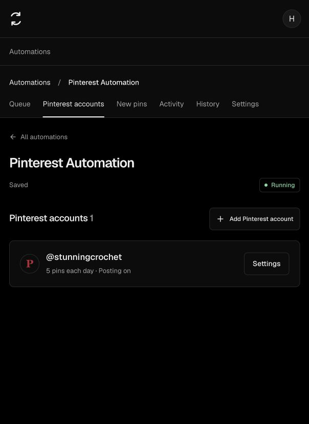
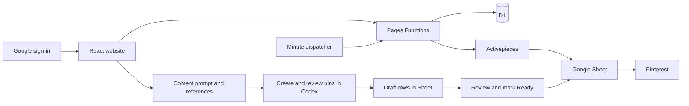

# Pinterest Automation

[](https://github.com/Houdaifa1/pinterest-automation-web/actions/workflows/checks.yml)

A simple home for Pinterest posting. Connect your accounts, choose a schedule, save examples of your picture style, and prepare a batch of pins. Activepieces publishes the queued pins from your Google Sheet.

[Open the website](https://automation.houdaifa.dev) · [Build and deployment checks](https://github.com/Houdaifa1/pinterest-automation-web/actions)



## Current status

The black, English-only website is live. Production checks have verified Google sign-in, read-only import of an existing flow with its Pinterest profile, and product discovery across all five pages of the test catalog (102 products). Prompts now include account research, current demand, exact product destinations and product-specific photography/mockup instructions. See [progress](docs/PROGRESS.md) for evidence and unresolved acceptance work.

End-to-end publication with the revised scheduling contract, live deployed-flow removal/recovery and generated mockup quality are still being tested. The scheduling dispatcher is deployed separately; its automatic release is not yet part of the website pipeline.

## What you can do

- Sign in with Google, without an invitation.
- Keep each automation and its Pinterest profiles together.
- Connect Activepieces once, with readable account names.
- Find an existing automation and keep its Sheet, schedule and Telegram without entering another token.
- Choose varied posting windows or exact minute times, with adjustable daily amounts.
- Pause, resume, start a run and inspect its status.
- Upload picture references for each profile.
- Mix no-link pins, individual products, category overview pins and selected store products in one request.
- Preview a product rotation that continues across creation parts, instead of grouping every product's pins into a block.
- Paste a whole shop or catalog link and let creation research choose relevant products, or choose exact product links yourself.
- Discover real product links across supported catalog pages, with visible partial-access limits.
- Prepare audience-specific research and creation instructions for fresh scenes, wearable mockups, exact artwork mockups and digital-resource previews.
- Emphasize verified free offers with readable image text; distinguish paid products, paid PDFs, samples and optional-payment resources.
- Review synced Draft pins, then mark approved content Ready; inspect actual Sheet counts and sync coverage.
- Recopy a saved batch, make a similar batch, and restore saved settings.
- Manage website members from the owner account.

The website prepares instructions; it does not generate images or perform trend research in the background. Use the prompt in a content-creation session with web, image, Drive and Sheets access. That session researches the designated account and sources, creates and checks the images, and saves Draft rows. Review them in the website before marking them Ready. Copying text does not attach image files: reference links give temporary access to the selected images. Download the prompt-and-images package when you prefer to attach the files yourself.

For a shop request, open **New pins → My website or store**, paste the shop/catalog URL, keep **Choose products for me**, choose the amount and click **Review request**. Individual product links are resolved during creation research. If a manual scan cannot read a store, **Use automatic research** continues without pretending the scan succeeded. You can also paste exact product links. Automatic selections are saved as a batch plan before image creation so a resumed batch keeps the same products and mixed order.

The compact prompt reuses verified research and shares topic checks across a batch. A measured 64-pin request became 57% shorter in characters while retaining product fidelity, offer checks and posting order. This is a prompt-size measurement, not measured billing savings.

For an existing setup, enter your Activepieces key and choose **Use existing automation**. This reads the saved setup; it does not republish the flow. To add a profile, open **Pinterest accounts → Add Pinterest account**, connect it in Activepieces if needed, then choose **Add & update automation**. Account settings are collapsed by default. Open **Settings**, make changes, then explicitly save and apply them. A paused schedule stays paused.

## How it fits together



React, TypeScript and Vite power the interface. Hono runs the API in Cloudflare Pages Functions. D1 stores private member data. The automation engine is in `engine/`.

## Run locally

Use Node.js 24 and Python 3.12 or later.

```sh
npm ci
cp .dev.vars.example .dev.vars
npm run db:local
npm run build
npm run dev
```

Open `http://127.0.0.1:8788`. Fill in your own local secrets before using Google sign-in. The development shortcut only works on loopback addresses with `DEV_LOGIN=true`.

```sh
npm test
npm run test:engine
npm run build
```

Tests cover member isolation, encrypted credentials, blocked sessions, request forgery, private references, batch history, deployment retries and separate automation Sheets. The engine tests use simulated services; they do not establish live publishing or beginner acceptance.

## Automatic deployment

A push to `main` runs the website tests, engine tests and production build. Deployment starts only after all checks pass. Pull requests run checks without production credentials.

The production job applies additive database migrations, uploads the checked build to Cloudflare Pages, and checks public health, authentication and development-login restrictions. Workflow actions are pinned to full commit IDs. Deployment secrets are kept in the GitHub `production` environment.

For your own installation:

1. Create a Cloudflare Pages project and D1 database.
2. Update `wrangler.jsonc` with your project, database, public domain and `OWNER_EMAIL` for member moderation.
3. Set `ENCRYPTION_KEY`, `GOOGLE_CLIENT_ID` and `GOOGLE_CLIENT_SECRET` as Cloudflare Pages secrets. Keep the encryption key stable; changing it without migrating stored credentials prevents decryption.
4. Create a Google web client with `https://YOUR_DOMAIN/auth/callback`. Request only `openid email profile` and publish its external audience.
5. Put a limited Cloudflare deployment token in the GitHub production environment as `CLOUDFLARE_API_TOKEN`, and set the environment variable `CLOUDFLARE_ACCOUNT_ID`.
6. For website scheduling, generate one dedicated random `DISPATCH_KEY` and save the same value as a secret in Pages and the dispatcher Worker. Do not expose it in source or browser code. Set the Worker origin in `wrangler.dispatcher.jsonc`, then deploy with `npx wrangler deploy --config wrangler.dispatcher.jsonc`. The Worker has no public route and ticks once a minute.
7. Push to `main`. Check both website jobs in GitHub Actions. Dispatcher changes currently require their own checked deployment; adding that release to CI requires a suitably scoped Workers Scripts permission.

The token needs Pages edit and D1 edit for the selected Cloudflare account. Google and Activepieces credentials belong in Cloudflare, never in GitHub source. Deployment does not change independently hosted member flows.

Database changes must remain compatible with the previous website release. A Pages rollback does not roll back D1 migrations. Export a database backup before a destructive schema change.

## Privacy and limits

- Google sign-in asks for identity only; automation connections are separate.
- Activepieces keys are encrypted with AES-GCM and member-bound context.
- Every private API request checks the signed-in member. Owner moderation does not expose keys or raw service logs.
- Reference images are private by default. Batch links expire after 24 hours; anyone holding a link can read that batch image until expiry or access revocation.
- Uploads are bounded to six active references per profile and 10 MB of stored references per member, with a shared storage ceiling.
- First deployment waits for a successful scheduled seed run. Activepieces scheduling can take several minutes. Run now needs a retained seed.

## Project map

| Folder | Purpose |
|---|---|
| `src/` | Black English-only website interface |
| `server/`, `functions/` | Authentication, ownership, integrations, mixed prompts, catalog discovery and API |
| `migrations/` | Ordered database migrations |
| `engine/` | Posting engine, legacy prompt templates and engine tests |
| `workers/` | Lightweight due-job scheduling dispatcher |
| `tests/` | Website security and integration checks |
| `docs/` | Decisions, research, progress and visual proof |
| `docs/prototype-v2/` | Separate black English-only redesign prototype and check results |

See [progress](docs/PROGRESS.md) for checked results and remaining acceptance work. Report security issues privately to the repository owner; do not include keys, tokens, private references or raw run outputs in an issue.
