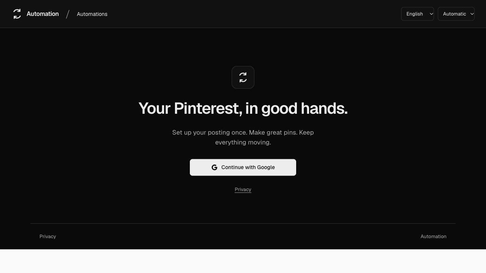
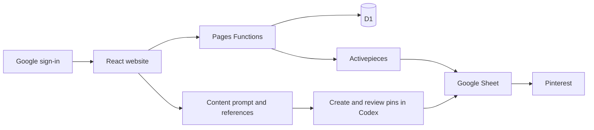

# Pinterest Automation

A simple home for Pinterest posting. Connect your accounts, choose a schedule, save examples of your picture style, and prepare a batch of pins. Activepieces publishes the queued pins from your Google Sheet.

[Open the website](https://automation.houdaifa.dev) · [Build and deployment checks](https://github.com/Houdaifa1/pinterest-automation-web/actions)



## What you can do

- Sign in with Google, without an invitation.
- Keep each automation and its Pinterest profiles together.
- Connect Activepieces once, with readable account names.
- Save posting times and apply a checked configuration.
- Pause, resume, start a run and inspect its status.
- Upload picture references for each profile.
- Copy a Codex prompt for page links, pins without links, or website rounds.
- Recopy a saved batch, make a similar batch, and restore saved settings.
- Manage website members from the owner account.

The website prepares instructions. Pins are created and reviewed in Codex, then added to the Sheet. Copying text does not attach image files: reference links give temporary access to the selected images. Download the prompt-and-images package when you prefer to attach the files yourself.

## How it fits together



React, TypeScript and Vite power the interface. Hono runs the API in Cloudflare Pages Functions. D1 stores private member data. The automation engine is in `engine/`.

## Run locally

Use Node.js 24 and Python 3.12 or later.

```sh
npm ci
cp .dev.vars.example .dev.vars
npm run db:local
npm run build
npm run dev
```

Open `http://127.0.0.1:8788`. Fill in your own local secrets before using Google sign-in. The development shortcut only works on loopback addresses with `DEV_LOGIN=true`.

```sh
npm test
npm run test:engine
npm run build
```

Tests cover member isolation, encrypted credentials, blocked sessions, request forgery, private references, batch history, deployment retries and separate automation Sheets. The engine tests use simulated services; they do not establish live publishing or beginner acceptance.

## Automatic deployment

A push to `main` runs the website tests, engine tests and production build. Deployment starts only after all checks pass. Pull requests run checks without production credentials.

The production job applies additive database migrations, uploads the checked build to Cloudflare Pages, and checks public health, authentication and development-login restrictions. Workflow actions are pinned to full commit IDs. Deployment secrets are kept in the GitHub `production` environment.

For your own installation:

1. Create a Cloudflare Pages project and D1 database.
2. Update `wrangler.jsonc` with your project, database and public domain.
3. Set `ENCRYPTION_KEY`, `GOOGLE_CLIENT_ID` and `GOOGLE_CLIENT_SECRET` as Cloudflare Pages secrets. Keep the encryption key stable; changing it without migrating stored credentials prevents decryption.
4. Create a Google web client with `https://YOUR_DOMAIN/auth/callback`. Request only `openid email profile` and publish its external audience.
5. Put a limited Cloudflare deployment token in the GitHub production environment as `CLOUDFLARE_API_TOKEN`, and set the environment variable `CLOUDFLARE_ACCOUNT_ID`.
6. Push to `main`. Check both jobs in GitHub Actions.

The token needs Pages edit and D1 edit for the selected Cloudflare account. Google and Activepieces credentials belong in Cloudflare, never in GitHub source. Deployment does not change independently hosted member flows.

Database changes must remain compatible with the previous website release. A Pages rollback does not roll back D1 migrations. Export a database backup before a destructive schema change.

## Privacy and limits

- Google sign-in asks for identity only; automation connections are separate.
- Activepieces keys are encrypted with AES-GCM and member-bound context.
- Every private API request checks the signed-in member. Owner moderation does not expose keys or raw service logs.
- Reference images are private by default. Batch links expire after 24 hours; anyone holding a link can read that batch image until expiry or access revocation.
- Uploads are bounded to six active references per profile and 10 MB of stored references per member, with a shared storage ceiling.
- First deployment waits for a successful scheduled seed run. Activepieces scheduling can take several minutes. Run now needs a retained seed.

## Project map

| Folder | Purpose |
|---|---|
| `src/` | Interface and English, French and Arabic text |
| `server/`, `functions/` | Authentication, ownership, integrations and API |
| `migrations/` | Ordered database migrations |
| `engine/` | Posting engine, prompt templates and engine tests |
| `tests/` | Website security and integration checks |
| `docs/` | Decisions, research, progress and visual proof |

See [progress](docs/PROGRESS.md) for checked results and remaining acceptance work. Report security issues privately to the repository owner; do not include keys, tokens, private references or raw run outputs in an issue.
